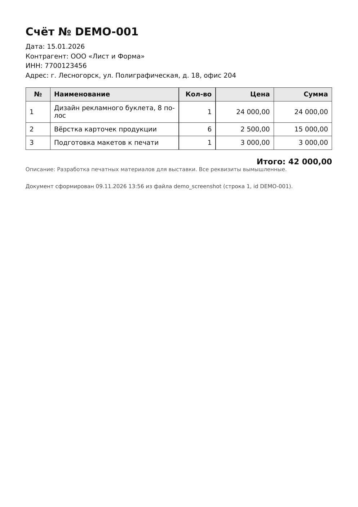

# PDF Document Generator

Генератор счетов, актов, чеков и других PDF-документов из CSV и JSON по HTML-шаблону.

## Проблема

Подготовка однотипных счетов, актов и чеков вручную требует повторного переноса данных в документы и занимает время. При большом количестве документов этот процесс становится трудоёмким.

## Решение

Утилита подставляет данные из CSV или JSON в HTML-шаблон и сохраняет результат в PDF. Можно выбрать отдельный документ или сформировать несколько документов за один запуск.

## Возможности

- Выбор данных, шаблона и документов через меню или аргументы командной строки.
- Загрузка CSV и четырёх структур JSON.
- Вложенные поля, циклы и фильтры в HTML-шаблонах.
- Кириллица в PDF через включённые шрифты DejaVu Sans.
- Создание одного или нескольких документов и автоматическое открытие результата.

Проект написан на Python; PDF создаются с помощью WeasyPrint. В комплект входят примеры данных, HTML-шаблон и шрифты.

## Результат

Программа создаёт отдельные PDF-файлы на основе выбранных данных и HTML-шаблона. Готовые документы сохраняются в папку `output/` или в другую папку, указанную при запуске.

**Пример созданного документа** (данные вымышленные):



## Как запустить

Нужен Python 3.10+. Установка зависимостей и системных библиотек описана в [INSTALL.md](INSTALL.md): для Windows требуется GTK Runtime, для macOS — системные библиотеки, перечисленные в инструкции. Шрифты уже включены в проект.

После установки из папки проекта выполните:

```bash
python generate.py --list
python generate.py --data data/example.json --template templates/chek_example.html --invoice INV-1001 --no-open
```

Первая команда покажет доступные данные и шаблоны, вторая создаст `output/example_INV-1001.pdf`. При повторном запуске к имени добавляется числовой суффикс.

Настройки находятся в `config.json`: каталоги данных и шаблонов, папка вывода и автоматическое открытие файлов. Относительные пути считаются от папки `generate.py`. Флаг `--no-open` отключает открытие результата. Для пакетной генерации используйте `--rows all --yes`.

## Условия работы и ограничения

- Поля данных должны соответствовать шаблону: отсутствующие значения остаются пустыми, а отсутствующий список делает блок цикла пустым; программа выводит предупреждения.
- Исходные примеры CSV и JSON содержат разные поля. Общий шаблон может выдавать такие предупреждения и на примерах из комплекта.
- Запуск на macOS пока не проверен.

## Тесты

Автоматические тесты проверяют загрузку данных, обработку шаблона и выбор документа. Запуск из папки проекта:

```bash
python -m unittest discover -s tests -v
```

Тесты не проверяют создание PDF и системные зависимости. Подробности — в [USAGE.md](USAGE.md).

## Структура проекта

```
generate.py              точка входа
core/                    конфиг, сканер, загрузчики, меню, рендер, PDF
templates/               HTML-шаблоны
data/                    CSV и JSON
fonts/                   DejaVuSans.ttf, DejaVuSans-Bold.ttf
output/                  готовые PDF
config.json
requirements.txt
```

## Документация

- [Установка и системные зависимости](INSTALL.md).
- [Команды, настройки, форматы данных и шаблоны](USAGE.md).

## Версия

**1.1.** Консольная утилита на Python 3.10+. Инструкция содержит подготовку для Windows и macOS; границы проведённой проверки указаны выше.

## Контакты

**Дмитрий Городничий**

- Email: `dmitrij.trud@yandex.ru`
- Telegram: [@dmitrij_radujsya](https://t.me/dmitrij_radujsya)
- GitHub: [dmitrijtrudradost](https://github.com/dmitrijtrudradost)
